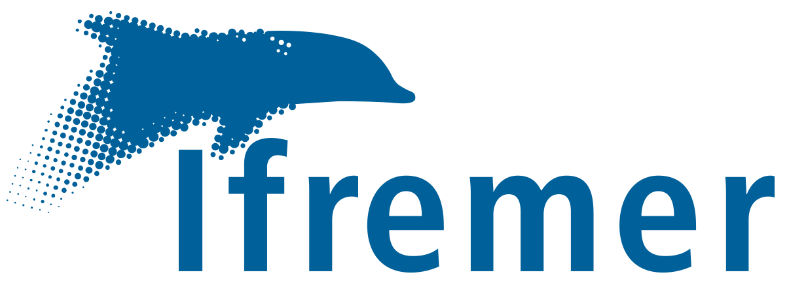
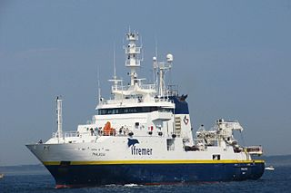
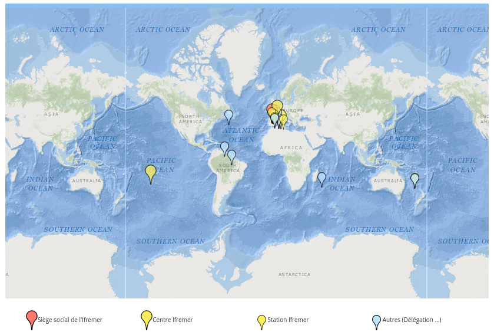
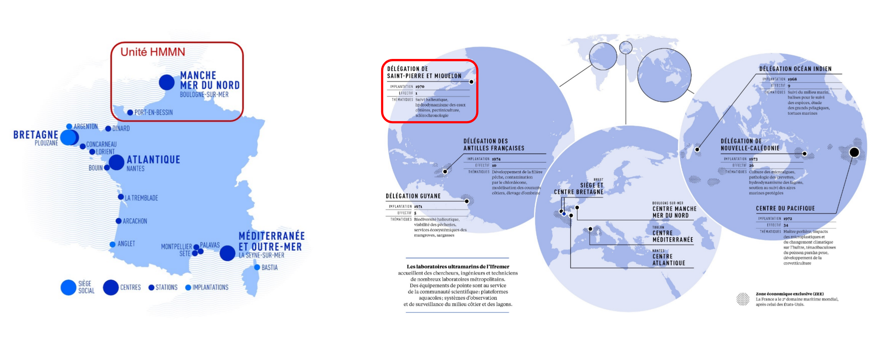

## Information générale

- Support du cours d'**introduction à l'halieutique**, Master 2 Sciences de la Mer, Université de Caen
- Accompagné de **travaux pratiques sous R** [@rcoreteam2024] : manipuler et analyser des données de pêche
- Document sous licence libre [MIT](https://fr.wikipedia.org/wiki/Licence_MIT) ; les textes [bleus]{style="color:#0064FF"} sont des liens cliquables

::: {.callout-box}
**Navigation** : flèches ← → · **F** plein écran · **O** vue d'ensemble · **S** notes de l'orateur · **E** version imprimable · **?** aide
:::

::: {.notes}
Ce document est le premier support du cours d'introduction à l'halieutique. Il
présente l'organisation pratique des deux journées puis l'Institut Français de
Recherche pour l'exploitation de la MER (IFREMER).

Tous les supports sont des présentations HTML produites avec Quarto. Pour les
étudier seul, ouvrez les notes de l'orateur avec la touche **S** : chaque
diapositive est accompagnée d'un texte qui reprend et complète ce qui est dit
oralement. La touche **E** affiche une version adaptée à l'impression (ou à
l'export PDF depuis le navigateur).

Le cours s'appuie sur le logiciel libre R, qui est l'outil de référence
pour l'analyse des données en écologie et particulièrement en halieutiques, notamment au sein du Conseil
international pour l'exploration de la mer (CIEM).
:::

## Organisation du cours {background-color="#0032C8" .chapter-slide}

01.

Quand, où, comment ?

## Calendrier et lieu

::: {.columns}
::: {.column width="55%"}
**12 heures en présentiel**, sur deux jours :

| | Matin | Après-midi |
|---|---|---|
| **Lundi 23 novembre** | 9h – 12h | 14h – 17h |
| **Mardi 24 novembre** | 9h – 12h | 14h – 17h |

: {tbl-colwidths="[40,30,30]"}

**Lieu** : CREC — Centre de recherches en environnement côtier, Luc-sur-Mer (bâtiment M4)
:::
::: {.column width="45%"}
::: {.callout-box}
**Matériel**

- un ordinateur
- [R](https://cran.r-project.org/) et [RStudio Desktop](https://posit.co/download/rstudio-desktop/) installés
- une connexion internet (téléchargement des données et des supports)
:::
:::
:::

::: {.notes}
Le cours représente 12 heures réparties en quatre demi-journées de trois heures,
le lundi 23 et le mardi 24 novembre, au CREC (Centre de recherches en
environnement côtier) de l'Université de Caen, à Luc-sur-Mer.

Les travaux pratiques se font sur ordinateurs. Vérifiez avant la
première séance pratique que R et RStudio sont installés et qu'ils
fonctionnent. Les exercices ont été écrits pour utiliser le moins de packages
possible, afin de limiter les problèmes d'installation. Les packages
nécessaires sont indiqués au début de chaque exercice.
:::

## Comment le cours est structuré

::: {.columns}
::: {.column width="50%"}
**Alternance cours magistraux / applications**

::: {.incremental}
- **Cours magistral** (~1h) : concepts, ordres de grandeur, enjeux de gestion
- **TP / TD sous R** (~2h) : mise en pratique immédiate sur des données réelles ou simulées
- Chaque demi-journée = un thème, un cours + une application
:::
:::
::: {.column width="50%"}
::: {.needs-box}
**Les TP sont des fichiers Quarto (`.qmd`)**

- énoncé, code R et questions dans un même document
- à ouvrir dans RStudio, à compléter et à exécuter
- compilable en HTML pour garder une trace de votre travail
:::
:::
:::

::: {.notes}
Chaque demi-journée suit le même principe : un cours magistral d'environ une
heure présente les notions, puis une séance pratique d'environ deux heures les
met en œuvre sous R. On apprend l'halieutique en manipulant des données : des
statistiques de débarquements, des données d'effort de pêche, des modèles de
dynamique des populations.

Les exercices sont fournis sous forme de documents Quarto (extension `.qmd`).
Un document Quarto mélange du texte (l'énoncé, vos réponses rédigées) et des
blocs de code R que l'on peut exécuter un par un dans RStudio. Une fois
terminé, il peut être compilé en un rapport HTML qui contient à la fois le
code, les résultats et vos commentaires. C'est une manière de travailler
reproductible, très utilisée en sciences halieutiques.
:::

## Programme indicatif

| Demi-journée | Cours magistral | Application sous R |
|---|---|---|
| **Lundi matin** | Organisation et Ifremer · Les outils : R, Quarto et recherche reproductible | Premiers pas avec R et Quarto |
| **Lundi après-midi** | La pêche, une activité humaine · Statistiques de pêche | Analyse de débarquements et d'efforts |
| **Mardi matin** | Modèles de dynamique des populations | Modèle de production |
| **Mardi après-midi** | Évolution des stocks et gestion | Application et synthèse |

: {tbl-colwidths="[22,39,39]"}

::: {.small}
Le contenu peut évoluer selon le rythme du groupe et vos questions.
:::

::: {.notes}
Ce programme est indicatif. La première matinée présente les outils de travail
du cours : le langage R, les documents Quarto et les principes de la recherche
reproductible (support `02_outils`). Le TD associé (`02_outils_application`)
permet de prendre en main R et Quarto avant de manipuler de vraies données.

L'après-midi pose le contexte halieutique. Le cours « La pêche, une activité
humaine » (support `03_peche`) retrace l'histoire de la pêche, ses usages (de
la subsistance au commerce mondial et au loisir) et les engins de capture,
avec les grands chiffres mondiaux, européens et français. Nous verrons ensuite
comment les données de pêche sont collectées puis analysées. La deuxième journée porte sur la modélisation : comment, à partir
des captures et d'indices d'abondance, estimer l'état d'un stock et le comparer
à des points de référence de gestion comme le rendement maximal durable (RMD,
ou MSY en anglais).
:::

## Ressources

Tous les supports sont disponibles ici : **<https://github.com/ldbk/cours_introduction_halieutique>**

- `presentations/` : les supports de cours (HTML et sources `.qmd`)
- `applications/` : les travaux pratiques (`.qmd`) et leurs données
- `presentations/img/` : les illustrations

::: {.callout-box}
**Contact** : Laurent Dubroca — prénom.nom@ifremer.fr\
Ifremer, Laboratoire Ressources Halieutiques de Port-en-Bessin
:::

::: {.notes}
Le dépôt GitHub contient tout le matériel du cours. Vous pouvez le télécharger
en entier (bouton « Code » puis « Download ZIP ») ou récupérer seulement les
fichiers d'un TP. Les présentations HTML s'ouvrent dans n'importe quel
navigateur, sans connexion internet.
:::

## Et l’intelligence artificielle ?

::: {.columns}
::: {.column width="50%"}
**Un outil devenu incontournable**

- Gains de temps et de qualité sur des tâches de rédaction [@noy2023] ou d’assistance, surtout pour les débutants [@brynjolfsson2025]
- Largement utilisée en entreprise ; les compétences en IA sont recherchées par les employeurs [@microsoft2024; @worldeconomicforum2025]
- Utile pour **expliquer** une erreur de code, **reformuler**, **explorer** une piste
:::
::: {.column width="50%"}
**Mais l'utiliser sans comprendre...**

- **Apprend moins** : de meilleurs exercices avec l'IA, de moins bons résultats à l'examen sans elle [@bastani2025]
- **Délègue sa réflexion** : moins d'effort et d'esprit critique [@gerlich2025; @lee2025]
- **Se trompe avec aplomb** : références inventées [@walters2023], réponses fausses hors de son domaine de compétence [@dellacqua2026]
:::
:::

::: {.needs-box}
**Dans ce cours** : l'IA est permise comme une aide, pas comme un substitut. Écrivez le code, faites les erreurs, corrigez-les **vous-même**. **L'examen se fait sur table, sans ordinateur** : seul ce que vous aurez compris et pratiqué comptera.
:::

::: {.notes}
Les outils d'intelligence artificielle générative (ChatGPT, Claude, Copilot,
Mistral...) sont aujourd'hui partout, y compris en sciences halieutiques. Il
serait illusoire de les interdire, et ce serait dommage : bien utilisés, ils
sont efficaces. Dans une expérience contrôlée, des professionnels qui
rédigeaient des documents avec ChatGPT ont gagné environ 40 % de temps, avec
une qualité jugée meilleure [@noy2023]. Dans un centre d'assistance client,
l’accès à un assistant d’IA a augmenté la productivité de 15 % en moyenne, avec
des gains concentrés chez les employés débutants [@brynjolfsson2025]. Les employeurs
attendent de plus en plus de leurs recrues qu'elles sachent utiliser ces
outils [@microsoft2024; @worldeconomicforum2025]. Savoir s'en servir avec discernement est
donc une compétence professionnelle.

Mais plusieurs études montrent les risques d'un usage sans compréhension. Dans
une expérience menée auprès de lycéens en mathématiques, les élèves qui
s’entraînaient avec GPT-4 réussissaient beaucoup mieux leurs exercices
(+48 %), mais obtenaient des résultats inférieurs de 17 % à ceux des autres
lors de l’examen sans accès à l’outil : ils avaient utilisé l'IA comme une béquille plutôt que pour
apprendre [@bastani2025]. D’autres travaux, fondés sur des enquêtes et donc
corrélationnels, associent un usage intensif de l’IA à un « délestage cognitif » : on confie sa réflexion à l'outil, on fait
moins d'effort et on exerce moins son esprit critique [@gerlich2025; @lee2025].

Ces outils se trompent aussi, avec une grande assurance. Ils inventent des
références bibliographiques qui n'existent pas [@walters2023]. Chez des
consultants, l'IA améliorait nettement les résultats pour les tâches
qu'elle maîtrisait bien, mais les dégradait pour une tâche située hors de son
domaine de compétence, que les utilisateurs ne savaient pas repérer
[@dellacqua2026]. Pour repérer une erreur, il faut comprendre ce que l'on
fait.

Dans ce cours, l'IA est donc permise comme une aide : pour comprendre un
message d'erreur, reformuler une notion, vérifier une idée. Mais le but des TD
est que vous écriviez et manipuliez le code vous-même, que vous fassiez des
erreurs et que vous les corrigiez. C'est ainsi que l'on apprend. Et de toute
façon, l'examen se déroulera sur table, sans ordinateur : seul ce que vous
aurez réellement compris et pratiqué vous sera utile.
:::

## Modalités d'évaluation

::: {.columns}
::: {.column width="50%"}
::: {.callout-box}
**Travaux pratiques : ⅓ de la note finale**

- À la fin de **chaque demi-journée comportant un TP/TD**, envoyez votre travail par **mail** à l'intervenant
- Fichier `.qmd` **et** sa version compilée (HTML)
- Chaque TP/TD est **noté**
:::
:::
::: {.column width="50%"}
::: {.needs-box}
**Épreuve sur table : ⅔ de la note finale**

- Examen écrit, **sans ordinateur**
- Les modalités précises seront présentées plus tard
- Sujets des années précédentes : `presentations/examen2024.pdf` et `presentations/examen2025.pdf`
:::
:::
:::

::: {.notes}
L'évaluation comporte deux parties.

Les travaux pratiques comptent pour un tiers de la note finale. À la fin de
chaque demi-journée qui comporte un TP ou un TD, envoyez votre travail par
mail à l'intervenant : le fichier Quarto (`.qmd`) que vous avez complété et sa
version compilée en HTML. Chaque TP ou TD sera noté. Ce qui compte, c'est la
démarche : un code qui fonctionne, des résultats commentés, un document qui
se compile. Un travail inachevé mais honnête vaut mieux qu'un travail
complet que vous ne comprenez pas.

Les deux autres tiers de la note proviennent d'une épreuve écrite sur table,
sans ordinateur. Ses modalités précises vous seront présentées plus tard.
Pour vous préparer, les sujets des années précédentes sont disponibles dans
le dépôt du cours, dans le répertoire `presentations/` (`examen2024.pdf` et
`examen2025.pdf`).
:::

## L'Ifremer {background-color="#0032C8" .chapter-slide}

02.

L'institut français de recherche entièrement dédié à l'Océan

## L'Ifremer en bref

::: {.columns}
::: {.column width="62%"}
- **Institut français de recherche pour l'exploitation de la mer**
- Créé en **1984** par la fusion :
  - de l'**ISTPM** (Institut scientifique et technique des pêches maritimes) — une expertise sur les pêches qui remonte à Napoléon III
  - du **CNEXO** (Centre national pour l'exploitation des océans)
- **EPIC** (établissement public à caractère industriel et commercial), sous la tutelle des ministères chargés de la **recherche**, de la **mer** et de l'**environnement**
- Environ **¼ de la recherche française** en sciences et technologies de la mer
:::
::: {.column width="38%"}
{fig-align="center" width=3in}

{fig-align="center" width=3.5in}
:::
:::

::: {.notes}
L'Ifremer est le seul institut de recherche français entièrement consacré à
l'Océan. Il est né en 1984 de la fusion de deux organismes. L'ISTPM était
l'héritier d'une longue tradition d'expertise sur les pêches maritimes, qui
remonte au Second Empire. Le CNEXO avait été créé dans les années 1960 pour
développer l'océanographie et les technologies d'exploration des océans. Cette
double origine explique que l'Ifremer couvre aujourd'hui aussi bien la
biologie des ressources exploitées que l'exploration des grands fonds.

Son statut d'EPIC lui permet de mener de la recherche publique tout en
travaillant avec des partenaires industriels. Ses missions sont fixées par un
contrat d'objectifs, de moyens et de performance avec l'État (COMP 2024-2028)
et par son projet stratégique « Horizon 2030 » [@ifremer2024brochure;
@ifremer2026ra].
:::

## Chiffres clés 2025

::: {.columns}
::: {.column width="33%"}
::: {.callout-box}
**1 623** personnes\
dont 85 doctorants et 39 post-doctorants

**49 %** de femmes
:::
:::
::: {.column width="33%"}
::: {.callout-box}
**274 M€** de fonctionnement\
**47 M€** d'investissement

**23** implantations
:::
:::
::: {.column width="33%"}
::: {.callout-box}
**562** publications\
(93 % en accès ouvert)

**75** avis et expertises pour l'État
:::
:::
:::

::: {.center-text .small}
Source : rapport annuel 2025 de l'Ifremer [@ifremer2026ra]
:::

::: {.notes}
Quelques ordres de grandeur pour situer l'institut. En 2025, l'Ifremer compte
1 623 personnes sous contrat, dont 1 329 dans les métiers de la science
(chercheurs, ingénieurs, techniciens) et 294 dans les métiers d'appui. Son
budget de fonctionnement est d'environ 274 millions d'euros.

L'activité de l'institut se mesure aussi par sa production scientifique (562
publications avec au moins un auteur Ifremer en 2025) et par son rôle
d'expert auprès de l'État : 75 avis et expertises ont été rendus en 2025, dont
23 portaient sur l'halieutique [@ifremer2026ra].
:::

## Quatre thèmes prioritaires (COMP 2024-2028)

::: {.columns}
::: {.column width="50%"}
::: {.callout-box}
**1. Scénarios d'évolution de l'océan**\
Jumeaux numériques, modélisation des écosystèmes, scénarios de gestion co-construits
:::
::: {.callout-box}
**2. Océan et transition énergétique**\
Énergies marines renouvelables (éolien en mer) : effets sur les écosystèmes et la pêche
:::
:::
::: {.column width="50%"}
::: {.needs-box}
**3. Conjuguer océan sain et nourricier**\
Biodiversité, bon état écologique, **pêche et aquaculture durables**
:::
::: {.callout-box}
**4. Protéger l'océan profond**\
Grands fonds : moins de 3 % explorés finement, ressources minérales convoitées
:::
:::
:::

::: {.center-text .small}
Source : contrat d'objectifs, de moyens et de performance État-Ifremer 2024-2028 [@ifremer2024comp]
:::

::: {.notes}
Le contrat d'objectifs, de moyens et de performance (COMP) signé entre l'État
et l'Ifremer pour 2024-2028 retient quatre thèmes interdisciplinaires
prioritaires. Ce sont des questions de société liées aux grandes transitions,
sur lesquelles l'Ifremer est attendu [@ifremer2024comp] :

1. **Comment construire et utiliser des scénarios d'évolution de l'océan ?**
   Il s'agit de développer des répliques numériques de l'océan (« jumeaux
   numériques ») qui combinent observations et modèles pour simuler l'effet des
   forçages naturels et humains. En halieutique, cela concerne par exemple des
   scénarios de résilience construits avec la filière pêche. Le système
   d'information halieutique (SIH) doit être modernisé dans ce cadre.
2. **En quoi l'océan peut-il contribuer à la transition énergétique ?** La
   France prévoit 18 GW d'éolien en mer installés en 2035 et 45 GW en 2050. Il
   faut comprendre les nouveaux écosystèmes créés par les parcs et leurs
   interactions avec la pêche et l'aquaculture.
3. **Peut-on conjuguer la santé de l'océan et sa fonction nourricière ?**
   C'est le thème le plus directement lié à ce cours. Il concilie la sécurité
   alimentaire (pêche et aquaculture) avec la préservation de la biodiversité.
   L'Ifremer y joue un rôle d'institut de référence pour la collecte des
   données et l'évaluation des ressources halieutiques dans le cadre de la
   Politique commune de la pêche (PCP). Ses scientifiques participent aux
   groupes de travail du CIEM, du CSTEP (Comité scientifique, technique et
   économique de la pêche) et des organisations régionales de gestion des
   pêches. La conciliation entre la pêche et la protection des dauphins dans le
   golfe de Gascogne en est un exemple typique.
4. **Comment protéger l'océan profond ?** Les grands fonds sont très mal
   connus (moins de 3 % explorés à haute résolution), alors qu'ils abritent des
   écosystèmes originaux et des ressources minérales convoitées. Les recherches
   doivent éclairer les négociations internationales, par exemple le traité
   BBNJ sur la haute mer.
:::

## Les grands moyens de l'Ifremer

::: {.columns}
::: {.column width="50%"}
- **Flotte océanographique française** : 17 navires et 6 engins sous-marins, opérée avec la filiale Genavir — environ 1 800 scientifiques embarqués chaque année
- **4 bassins d'essais**, dont un dédié aux **engins de pêche** (Lorient)
- **Plateformes expérimentales** pour l'aquaculture (mollusques, poissons, crustacés)
:::
::: {.column width="50%"}
- **Observation** : contribution française au programme **Argo** (≈ 4 000 flotteurs dans le monde)
- **Données** : portail [data.ifremer.fr](https://data.ifremer.fr), pôle de données Odatis
- **Calcul** : supercalculateur **Datarmor** (70 Po de stockage)
:::
:::

::: {.notes}
Pour la recherche halieutique, deux de ces moyens sont essentiels. Les
navires de la flotte réalisent chaque année les campagnes scientifiques
d'évaluation des ressources. Ces campagnes répètent le même protocole
d'échantillonnage d'une année sur l'autre et fournissent des indices
d'abondance indépendants de la pêche commerciale. Les systèmes d'information
stockent et diffusent les données de pêche, sur lesquelles reposent les
évaluations de stocks. Le bassin de Lorient sert à tester et à améliorer la
sélectivité des engins de pêche, par exemple pour réduire les captures non
désirées [@ifremer2024brochure].
:::

## Présent sur les trois océans

::: {.columns}
::: {.column width="55%"}
{fig-align="center" width=6in}
:::
::: {.column width="45%"}
- **5 centres** : Manche–Mer du Nord, Bretagne, Atlantique, Méditerranée et Outre-mer, Pacifique
- Siège à Plouzané (Brest)
- La France a le **2^e^ domaine maritime mondial**, grâce aux Outre-mer

::: {.callout-box}
**Centre Manche–Mer du Nord** : Boulogne-sur-Mer et **Port-en-Bessin**
:::
:::
:::

::: {.notes}
L'Ifremer est implanté sur toutes les façades maritimes de l'Hexagone et dans
les Outre-mer (Antilles, Guyane, océan Indien, Polynésie française,
Nouvelle-Calédonie, Saint-Pierre-et-Miquelon). C'est important pour
l'halieutique : les pêcheries, les espèces exploitées et les modes de gestion
sont très différents entre la Manche, le golfe de Gascogne, la Méditerranée et
les zones tropicales.

En Normandie, l'Ifremer est présent à Port-en-Bessin, où se trouve le
laboratoire Ressources Halieutiques auquel appartient l'intervenant.
:::

## L'halieutique à l'Ifremer

::: {.columns}
::: {.column width="55%"}
**Appui aux politiques publiques**

- Environ **⅓ du personnel** impliqué chaque année
- **17 dispositifs** de surveillance et de collecte de données, dont l'évaluation des ressources halieutiques
- Contribution aux groupes d'experts du **CIEM** (Conseil international pour l'exploration de la mer)
:::
::: {.column width="45%"}
::: {.needs-box}
**État des populations de poissons pêchées en France hexagonale (bilan 2023)**

- **58 %** des volumes débarqués proviennent de populations exploitées durablement
- mais une progression lente, et un **renouvellement des générations en baisse**
:::
:::
:::

::: {.notes}
L'appui aux politiques publiques fait partie des missions de l'Ifremer. Il
mobilise environ un tiers des salariés chaque année. En halieutique, cela
consiste à collecter les données de pêche (débarquements, effort, échantillonnage
des captures au port et à bord, campagnes scientifiques), à les transmettre
aux instances européennes et à participer aux groupes de travail du CIEM qui
évaluent l'état des stocks et produisent les avis scientifiques. Ces avis
servent ensuite à fixer les totaux admissibles de captures (TAC) dans le cadre
de la Politique commune de la pêche.

Chaque année, l'Ifremer publie un bilan de l'état des populations de poissons
pêchées en France hexagonale. Selon le bilan 2023, 58 % des volumes débarqués
proviennent de populations exploitées durablement. Mais la part des
populations non surpêchées progresse peu, et le renouvellement des générations
(l'arrivée de jeunes poissons dans la population) diminue nettement
[@ifremer2026ra]. Nous reviendrons sur ces notions (surpêche, recrutement,
exploitation durable) dans les prochains cours.
:::

## Quelques travaux récents

::: {.columns}
::: {.column width="33%"}
**Delmoges** (2022-2025)

Captures accidentelles de dauphins communs dans le golfe de Gascogne : le réchauffement concentre leurs proies près des côtes, dans les zones de pêche hivernales.
:::
::: {.column width="33%"}
**SEAwise** (2020-2025)

Projet européen sur la **gestion écosystémique des pêches** : modèles de complexité intermédiaire et critères définis avec les parties prenantes.
:::
::: {.column width="33%"}
**OSMOSE – Manche Est**

Modélisation des effets de l'**éolien en mer** sur l'écosystème et la pêche : légère baisse de la biomasse et des rendements quel que soit le scénario.
:::
:::

::: {.center-text .small}
Source : rapport annuel 2025 de l'Ifremer [@ifremer2026ra]
:::

::: {.notes}
Ces trois exemples montrent que l'halieutique actuelle ne se limite pas à
évaluer un stock isolé. Elle prend en compte les interactions entre la pêche
et le reste de l'écosystème.

**Delmoges** a croisé observations aériennes, acoustique, analyses biologiques
et données d'effort de pêche pour cartographier le risque de capture
accidentelle de dauphins.

**SEAwise** a cherché à rendre opérationnelle la gestion écosystémique des
pêches. Celle-ci doit concilier préservation de la biodiversité, exploitation
durable et répartition équitable des bénéfices de la pêche.

Le modèle **OSMOSE** représente le cycle de vie des poissons et leurs relations
trophiques. Il a été utilisé pour simuler jusqu'en 2050 l'effet des parcs
éoliens et de différentes règles de pêche en Manche Est, un sujet très
concret pour la Normandie.
:::

## Le laboratoire Ressources Halieutiques de Port-en-Bessin

{fig-align="center" width=8in}

::: {.notes}
Le laboratoire de Port-en-Bessin fait partie de l'unité Halieutique Manche–Mer
du Nord. Il travaille sur les ressources exploitées de la Manche et en
particulier de la baie de Seine : collecte des données de pêche auprès des
professionnels et dans les criées, campagnes scientifiques, évaluation des
stocks et expertise pour les gestionnaires. Les données et les questions
abordées dans les travaux pratiques viennent en grande partie de cette
activité.
:::

## Références {.smaller .scrollable}

::: {#refs}
:::
