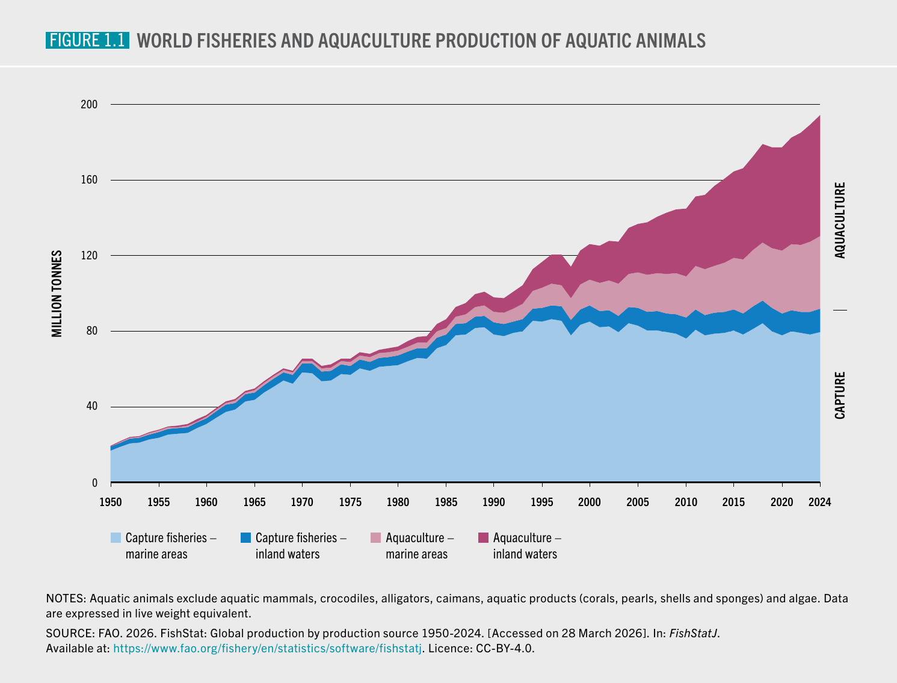
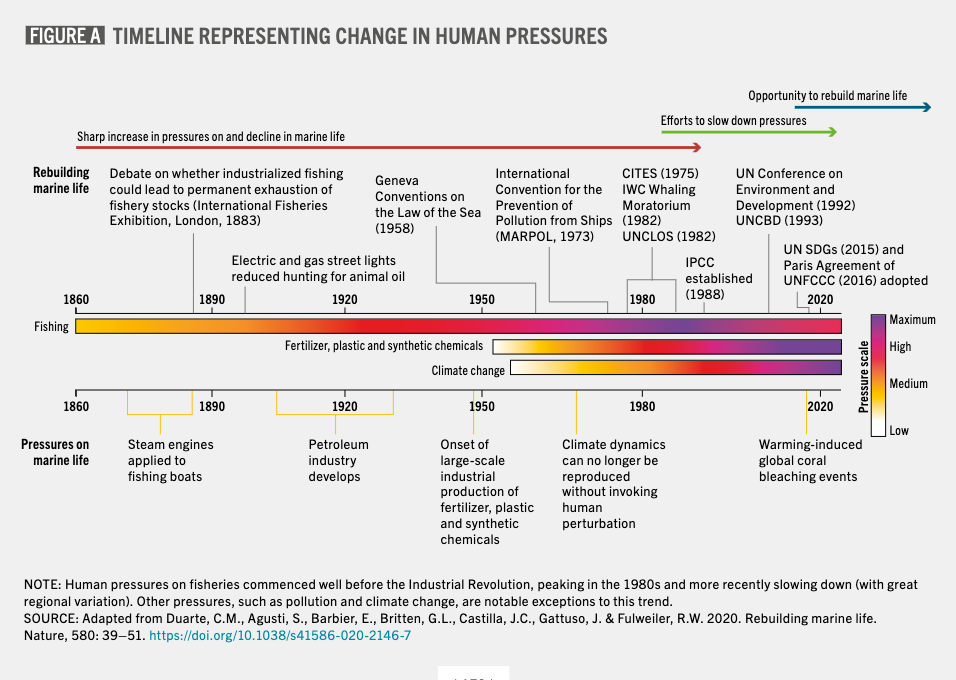
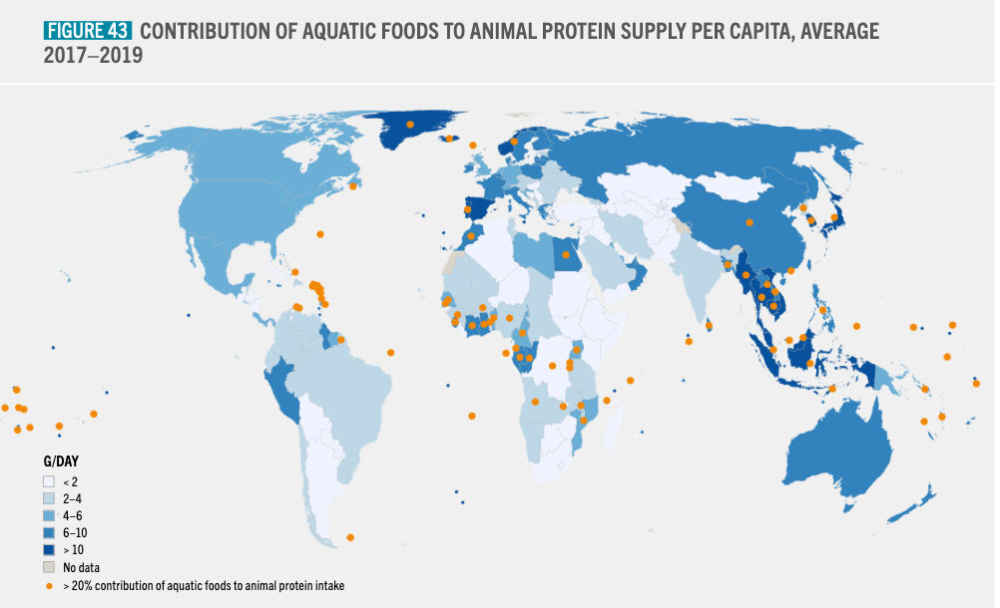
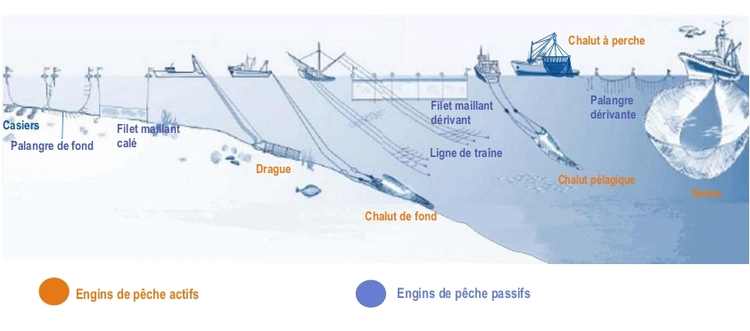

## Plan

1. **Qu'est-ce que la pêche ?** Définitions et ordres de grandeur
2. **Une longue histoire** : de la préhistoire à la pêche industrielle
3. **À quoi sert la pêche ?** Se nourrir, vivre, commercer, se divertir
4. **Les engins de pêche** : comment les humains capturent les ressources aquatiques

::: {.notes}
Ce cours présente la pêche comme une activité humaine, avant d'aborder dans
les cours suivants les données de pêche et l'évaluation des ressources.

Nous commencerons par quelques définitions et les grands chiffres actuels.
Nous verrons ensuite que la pêche est une des plus anciennes activités
humaines, et que son histoire éclaire la situation actuelle des ressources.
Nous détaillerons à quoi sert la pêche, de la subsistance d'une famille au
commerce mondial en passant par le loisir. Enfin, nous passerons en revue les
principaux engins utilisés pour capturer les animaux aquatiques.
:::

## Qu'est-ce que la pêche ? {background-color="#0032C8" .chapter-slide}

01.

Définitions et ordres de grandeur

## Quelques définitions

::: {.columns}
::: {.column width="55%"}
- **Pêche** : capture d'animaux aquatiques (poissons, crustacés, mollusques...) dans leur milieu naturel, en mer ou en eau douce
- **Aquaculture** : *élevage* d'organismes aquatiques. La pêche est un *prélèvement* sur une ressource sauvage
- **Captures** : quantités prélevées dans le milieu ; **débarquements** : quantités ramenées à terre
- **Halieutique** : science de l'exploitation des ressources vivantes aquatiques, l'équivalent de l'agronomie pour les milieux aquatiques
:::
::: {.column width="45%"}
::: {.callout-box}
**Halieutique**, du grec *halieutikos* : « qui concerne la pêche ».

Les *Halieutiques* d'Oppien (IIe siècle) décrivent déjà plus de 120 poissons et de nombreuses techniques de pêche [@leloch2019].
:::

::: {.needs-box}
Ce cours porte sur les **pêches maritimes**.
:::
:::
:::

::: {.notes}
La pêche consiste à capturer des animaux aquatiques sauvages dans leur milieu
naturel : c'est un prélèvement sur une ressource sauvage, alors que
l'aquaculture correspond à l'élevage. Cette distinction est importante : un
pêcheur ne contrôle ni la reproduction ni la croissance de la ressource qu'il
exploite. Il dépend du renouvellement naturel des populations, ce qui pose la
question de la gestion.

On distingue les captures (tout ce qui est pris par l'engin) des débarquements
(ce qui est ramené à terre). La différence correspond aux rejets : les
individus trop petits, sans valeur commerciale ou hors quota, rejetés à la mer.

Le mot « halieutique » vient du grec. Le poème *Halieutiques* d'Oppien, écrit
au IIe siècle de notre ère, décrit déjà les poissons et les techniques de pêche
de la Méditerranée avec une grande précision [@leloch2019]. L'halieutique est
aujourd'hui la science de l'exploitation des ressources vivantes aquatiques.
Ce cours se concentre sur les pêches maritimes.
:::

## La pêche et l'aquaculture dans le monde

::: {.columns}
::: {.column width="58%"}
{fig-align="center" width=6.2in}
:::
::: {.column width="42%"}
En 2024 [@2026b; @fao2024] :

- **235 Mt** produites, dont **195 Mt** d'animaux aquatiques
- **Pêche : 92 Mt**, stable depuis la fin des années 1980 (entre 86 et 94 Mt)
- **Aquaculture : 103 Mt**, soit **53 %** des animaux aquatiques : elle dépasse la pêche depuis 2022
- **4,7 millions** de navires de pêche
- **65 millions** d'emplois dans la production
:::
:::

::: {.notes}
La FAO, l'organisation des Nations unies pour l'alimentation et l'agriculture,
publie tous les deux ans un bilan mondial de la pêche et de l'aquaculture.
Selon l'édition 2026, la production mondiale a atteint 235 millions de tonnes
en 2024, dont 195 millions de tonnes d'animaux aquatiques et 40 millions de
tonnes d'algues [@2026b].

La figure montre une évolution majeure. Les captures de la pêche (en bleu) ont
augmenté rapidement des années 1950 aux années 1980, puis stagnent depuis entre
86 et 94 millions de tonnes. Toute la croissance récente vient de l'aquaculture
(en rose), qui a dépassé la pêche pour les animaux aquatiques. La stagnation
des captures traduit le fait que de nombreux stocks sauvages ont atteint leurs
limites biologiques.

La pêche reste néanmoins une activité considérable : environ 4,7 millions de
navires, dont les deux tiers sont motorisés, et 65 millions de personnes
employées dans la production (pêche et aquaculture), essentiellement en Asie.

Ces statistiques officielles sous-estiment probablement les captures réelles.
En intégrant la pêche artisanale, de subsistance et de loisir ainsi que les
rejets, une reconstruction estime le pic des captures marines mondiales à 130
millions de tonnes en 1996, contre 86 millions dans les données de la FAO
[@pauly2016].
:::

## Une longue histoire {background-color="#0032C8" .chapter-slide}

02.

De la préhistoire à la pêche industrielle

## Aux origines : la préhistoire

::: {.columns}
::: {.column width="55%"}
| Âge | Site | Indice |
|---|---|---|
| ~106 000–86 000 ans | Figueira Brava (Portugal) | Néandertaliens consommant poissons, crabes, mollusques [@zilhao2020] |
| ~90 000 ans | Katanda (RD Congo) | pointes en os barbelées, restes de poissons-chats [@yellen1995] |
| ~42 000 ans | Jerimalai (Timor oriental) | poissons pélagiques du large ; un hameçon plus récent, ~23 000–16 000 ans [@oconnor2011] |
| ~23 000 ans | Sakitari (Okinawa) | hameçons en coquillage [@fujita2016] |

: {tbl-colwidths="[22,28,50]"}
:::
::: {.column width="45%"}
::: {.callout-box}
**La pêche est l'une des plus anciennes activités humaines.**

Elle précède l'agriculture et l'élevage de plusieurs dizaines de milliers d'années.
:::

::: {.small}
Les datations les plus anciennes restent discutées.
:::
:::
:::

::: {.notes}
Les humains exploitent les ressources aquatiques depuis très longtemps. Au
Portugal, la grotte de Figueira Brava montre que des Néandertaliens
consommaient régulièrement des mollusques, des crabes et des poissons il y a
environ 106 000 à 86 000 ans [@zilhao2020]. À Katanda, en République
démocratique du Congo, des pointes en os barbelées, datées d'environ 90 000
ans, sont associées à de nombreux restes de poissons-chats [@yellen1995]. Cette
datation est toutefois discutée.

À Jerimalai, au Timor oriental, des humains modernes pêchaient il y a environ
42 000 ans des poissons pélagiques, c'est-à-dire de pleine eau, ce qui suppose
des techniques déjà élaborées. Le même site a livré, dans des niveaux plus
récents (environ 23 000 à 16 000 ans), l'un des plus anciens hameçons connus
[@oconnor2011]. À Okinawa, la grotte de Sakitari a livré des hameçons
taillés dans des coquillages, datés d'environ 23 000 ans [@fujita2016].

La pêche est donc bien plus ancienne que l'agriculture, apparue il y a environ
10 000 ans. Harpons, hameçons, puis filets et pièges ont été inventés très tôt.
:::

## L'Antiquité : techniques et commerce

::: {.columns}
::: {.column width="55%"}
- **Égypte** (~3000 av. J.-C.) : harpons, lignes à plusieurs hameçons, nasses, **filets** tirés par des équipes d'hommes
- **Méditerranée** : guet et capture du **thon rouge** en migration ; ces pêches donneront plus tard les **madragues** (*almadrabas*), encore utilisées en Espagne et en Sardaigne
- **Rome** : sennes, éperviers, filets maillants, engins traînants proches du chalut ; viviers ; commerce du poisson salé et du *garum*
:::
::: {.column width="45%"}
::: {.callout-box}
**La conservation change tout**

Séchage, salage, fumage, fermentation : le poisson devient une **marchandise** transportable et échangeable.
:::
:::
:::

::: {.notes}
Dans l'Égypte ancienne, le poisson est un aliment de base. Les représentations
de scènes de pêche, dès 3000 ans avant notre ère, montrent des harpons, des
lignes portant plusieurs hameçons, des nasses et des filets tirés par des
équipes d'hommes [@leloch2019]. Les filets eux-mêmes sont bien plus anciens :
on en a retrouvé en Europe du Nord datant du Mésolithique.

En Méditerranée, la migration du thon rouge est exploitée depuis l'Antiquité.
Ces pêches côtières ont donné naissance aux madragues (*almadrabas* en
espagnol, d'origine arabe) : de grands labyrinthes de filets fixes qui
interceptent les thons. Elles sont surtout attestées à partir du Moyen Âge et
fonctionnent encore aujourd'hui en Espagne et en Sardaigne. Les Romains connaissent presque tous les types d'engins actuels :
sennes, éperviers, filets maillants et même des engins traînants proches du
chalut. La Gaule devient un grand fournisseur de poisson de l'Empire
[@leloch2019].

Le point clé est l'apparition des techniques de conservation : séchage,
salage, fumage, fermentation (le *garum* romain est une sauce de poisson
fermenté). Elles permettent de transporter le poisson loin de son lieu de
capture. La pêche n'est plus seulement une activité de subsistance : elle
alimente un commerce.
:::

## Moyen Âge : hareng et morue

::: {.columns}
::: {.column width="50%"}
- Vers **l'an 1000** en Angleterre : forte augmentation des captures marines de hareng et de morue, le « *fish event horizon* » [@barrett2004]
- **Hareng** : la **Ligue hanséatique** (XIIIe siècle) organise les campagnes, la conservation, le transport et la vente
- **Morue** : de la Norvège à l'Islande, puis **Terre-Neuve** (XVIe siècle). En 1573, 330 navires y pêchent, dont 150 français [@leloch2019]
:::
::: {.column width="50%"}
> « La morue, à elle seule, a créé des colonies, fondé des comptoirs et des villes. »
>
> Jules Michelet, *La Mer* (1861), cité par @leloch2019

::: {.callout-box}
Hareng et morue sont les **premières pêcheries de masse** et la base d'une **économie maritime** européenne.
:::
:::
:::

::: {.notes}
L'archéologie montre qu'en Angleterre, vers l'an 1000, les restes de poissons
marins (hareng, morue) deviennent brusquement abondants dans les sites, alors
que les poissons d'eau douce dominaient auparavant. James Barrett et ses
collègues parlent d'un « horizon des poissons » (*fish event horizon*). Il
correspond au développement d'une pêche maritime à grande échelle, liée à la
croissance des villes et aux interdits alimentaires religieux (jours maigres)
[@barrett2004].

Le hareng, salé en barils, devient une marchandise majeure de l'Europe du
Nord. Au XIIIe siècle, la Ligue hanséatique, une association de villes
marchandes, organise la filière, de la capture à la vente.

La morue séchée ou salée suit le même chemin. Exploitée d'abord en Norvège,
elle est ensuite pêchée au large de l'Islande, puis sur les bancs de
Terre-Neuve après le voyage de Jean Cabot en 1497. En 1573, 330 navires
européens pêchent à Terre-Neuve, dont 150 français [@leloch2019]. La
« grande pêche » à la morue restera une activité majeure des ports bretons et
normands, comme Saint-Malo ou Fécamp, jusqu'au XXe siècle.
:::

## La révolution industrielle

::: {.columns}
::: {.column width="55%"}
- **XIXe siècle** : conserve, chemin de fer et glace élargissent les marchés
- **Fin du XIXe** : les **chalutiers à vapeur** remplacent la voile ; la pêche ne dépend plus du vent
- **XXe siècle** : moteur diesel, fibres synthétiques, sondeurs, congélation à bord ; flottes de **pêche lointaine** après 1945 (URSS, Japon, Espagne...)
- **1950 → 1990** : les captures mondiales passent d'environ 20 à 90 Mt
:::
::: {.column width="45%"}
::: {.needs-box}
**Un rendement qui s'effondre**

Au Royaume-Uni, les débarquements des chalutiers de fond **par unité de puissance de pêche** ont baissé de **94 %** en 118 ans (1889-2007) [@thurstan2010].
:::
:::
:::

::: {.notes}
Au XIXe siècle, plusieurs innovations transforment la pêche. La conserve
(inventée par Nicolas Appert au début du siècle), la glace et le chemin de fer
permettent d'acheminer le poisson frais ou conservé vers les villes de
l'intérieur. À la fin du siècle, les chalutiers à vapeur remplacent les
voiliers en mer du Nord. Ils peuvent tirer des chaluts plus lourds, plus
longtemps, quelle que soit la météo.

Au XXe siècle, le moteur diesel, les filets en fibres synthétiques, les
sondeurs acoustiques pour détecter les bancs et la congélation à bord
augmentent encore la puissance de pêche. Après la Seconde Guerre mondiale,
l'URSS, le Japon, l'Espagne ou la Pologne développent des flottes qui pêchent
sur toutes les mers du globe. Les captures mondiales sont multipliées par plus
de quatre entre 1950 et la fin des années 1980.

Les séries historiques montrent le revers de cette croissance. Au Royaume-Uni,
les débarquements des chalutiers de fond rapportés à leur puissance de pêche
ont chuté de 94 % entre 1889 et 2007 [@thurstan2010]. Il faut aujourd'hui
beaucoup plus d'effort pour capturer la même quantité de poisson : c'est le
signe d'une forte diminution de l'abondance.
:::

## Liberté des mers et appropriation

::: {.columns}
::: {.column width="50%"}
**Grotius**, *Mare liberum* (1609) : la mer est libre, et ses richesses sont trop abondantes pour être épuisées (idée résumée)

- Jusqu'aux années 1970 : accès quasi libre au large ; premières revendications à 200 milles par le Chili et le Pérou dès 1947-1952
- **Zone économique exclusive (ZEE)** de 200 milles, négociée à partir de 1973 et inscrite dans la **Convention de Montego Bay** (1982)
- ~90 % des pêcheries passent sous le contrôle des États côtiers [@leloch2019]
:::
::: {.column width="50%"}
::: {.callout-box}
**La « tragédie des communs »**

Quand une ressource est en accès libre, chacun a intérêt à capturer le plus possible avant les autres, même si tous y perdent à terme [@hardin1968].

C'est l'un des fondements de la **gestion des pêches**.
:::
:::
:::

::: {.notes}
Pendant des siècles, la mer a été considérée comme un espace libre et ses
ressources comme inépuisables. Le juriste néerlandais Grotius défend en 1609
la liberté des mers (la phrase de la diapositive résume son idée, ce n'est pas
une citation exacte). Cette idée a longtemps empêché toute réglementation de la
pêche au large [@leloch2019].

Avec l'intensification de la pêche, les conflits se multiplient (les « guerres
de la morue » entre l'Islande et le Royaume-Uni en sont un exemple). Les États
étendent progressivement leurs eaux territoriales. Le Chili et le Pérou
revendiquent dès 1947, puis avec l'Équateur en 1952, une zone de 200 milles. Négociée à partir de 1973,
la Convention des Nations unies sur le droit de la mer, signée à Montego Bay en
1982, crée la zone économique exclusive (ZEE). Jusqu'à 200 milles marins (370
km) de ses côtes, un État a des droits souverains sur les ressources. Comme
l'essentiel des pêcheries se trouve sur les plateaux continentaux, environ 90 %
d'entre elles passent sous contrôle national.

Ce changement illustre un problème central de l'halieutique, popularisé par
l'écologue Garrett Hardin sous le nom de « tragédie des communs »
[@hardin1968]. Quand l'accès à une ressource est libre, chaque
pêcheur a intérêt à pêcher le plus possible avant les autres, ce qui conduit
à la surexploitation. Définir qui a le droit de pêcher, combien et comment,
c'est l'objet de la gestion des pêches.
:::

## Effondrements et prise de conscience

::: {.columns}
::: {.column width="50%"}
**La morue de Terre-Neuve**

- Captures maximales à la fin des années 1960 (~800 000 t), puis déclin [@leloch2019]
- **2 juillet 1992** : moratoire sur la pêche de la morue du Nord [@hutchings1994]
- ~30 000 emplois perdus à Terre-Neuve ; stock toujours très bas dix ans plus tard [@hutchings2004]

**Les baleines** : jusqu'à 50 000 captures par an dans les années 1930, moratoire commercial en 1986 [@leloch2019]
:::
::: {.column width="50%"}
**Des concepts clés**

- **Référentiel glissant** (*shifting baseline*) : chaque génération prend pour « normal » l'état qu'elle a connu [@pauly1995]
- **Pêche vers le bas des réseaux trophiques** : la pêche se reporte vers des espèces plus petites, de niveau trophique plus bas [@pauly1998a]
- La surpêche a précédé les autres perturbations des écosystèmes côtiers [@jackson2001]
:::
:::

::: {.notes}
La morue du Nord, au large de Terre-Neuve et du Labrador, est l'exemple le
plus célèbre d'effondrement d'un stock. Après un maximum des captures à la fin
des années 1960, avec l'arrivée des chalutiers-usines étrangers, le stock
décline. Les évaluations surestiment son abondance. Le 2 juillet 1992, le
Canada ferme la pêche [@hutchings1994]. Environ 30 000 personnes perdent leur
emploi à Terre-Neuve (les estimations varient selon ce que l'on compte), et le
stock reste à un niveau très bas plus de dix ans après [@hutchings2004]. La
pression de pêche a même modifié la biologie de l'espèce : les morues mûrissent
plus jeunes et plus petites [@olsen2004c]. La
chasse à la baleine a suivi la même trajectoire, avec l'effondrement de
nombreuses populations avant le moratoire de 1986.

Ces crises ont fait naître plusieurs concepts. Daniel Pauly a décrit le
« syndrome du référentiel glissant » : chaque génération de scientifiques ou
de pêcheurs prend pour référence l'état de la ressource qu'elle a connu au
début de sa carrière, et sous-estime ainsi le déclin à long terme
[@pauly1995]. Le même auteur a montré que le niveau trophique moyen des
captures mondiales a diminué entre 1950 et 1994. Le niveau trophique indique la
position d'une espèce dans la chaîne alimentaire : 1 pour les végétaux, 2 pour
les herbivores, environ 4 ou plus pour les grands prédateurs comme le thon ou
la morue. Une fois les grands
prédateurs raréfiés, la pêche se reporte vers des espèces plus petites
[@pauly1998a]. Enfin, une synthèse historique a montré que la surpêche est la
première perturbation humaine des écosystèmes côtiers, bien avant la
pollution ou le changement climatique [@jackson2001].
:::

## Deux siècles de pressions sur l'océan

{fig-align="center" width=8.8in}

::: {.center-text .small}
Source : @duarteRebuildingMarineLife2020, reproduit par la FAO
:::

::: {.notes}
Cette frise, issue d'une synthèse publiée dans Nature, résume l'histoire des
pressions humaines sur la vie marine depuis 1860
[@duarteRebuildingMarineLife2020]. La pêche est la première pression à
augmenter, dès la révolution industrielle et l'arrivée des moteurs à vapeur.
Elle culmine dans les années 1980. Les pollutions puis le changement
climatique s'ajoutent ensuite.

La partie haute rappelle les grandes étapes de la régulation : débat sur
l'épuisement des ressources (Exposition internationale des pêches de Londres,
1883), conventions de Genève sur le droit de la mer (1958), moratoire sur la
chasse à la baleine (1982, effectif en 1986), convention de Montego Bay
(1982), objectifs de développement durable (2015).

Les auteurs soulignent aussi que les pressions de pêche diminuent dans
plusieurs régions, ce qui ouvre la possibilité de reconstituer certaines
populations.
:::

## À quoi sert la pêche ? {background-color="#0032C8" .chapter-slide}

03.

Se nourrir, vivre, commercer, se divertir

## D'abord, nourrir

::: {.columns}
::: {.column width="55%"}
- **89 %** de la production d'animaux aquatiques est destinée à l'alimentation humaine ; le reste devient surtout **farine et huile** de poisson
- **21,3 kg** par habitant et par an en 2024 : de 9,1 kg en Afrique à 26,3 kg en Asie
- Au moins **20 %** des protéines animales pour **3,1 milliards** de personnes
- En Afrique : peu consommé en quantité, mais **19 %** des protéines animales
:::
::: {.column width="45%"}
{fig-align="center" width=5in}

::: {.center-text .small}
Apport en protéines animales issues des produits aquatiques, 2017-2019 [@fao2022]
:::
:::
:::

::: {.notes}
La première fonction de la pêche est alimentaire. Selon la FAO, 89 % de la
production mondiale d'animaux aquatiques est consommée directement par les
humains. Le reste sert surtout à fabriquer des farines et des huiles de
poisson, utilisées notamment dans l'alimentation des animaux d'élevage et des
poissons d'aquaculture [@2026b].

La disponibilité moyenne atteint 21,3 kg par habitant et par an, avec de
fortes inégalités : environ 9 kg en Afrique, plus de 26 kg en Asie. Les
produits aquatiques fournissent au moins 20 % des protéines animales
consommées par 3,1 milliards de personnes. Ils apportent aussi des
micronutriments essentiels (oméga-3, iode, vitamines, fer, zinc).

L'Afrique illustre un paradoxe : on y consomme peu de poisson en quantité,
mais il représente près d'un cinquième des protéines animales disponibles,
car c'est souvent la source de protéines la plus accessible et la moins chère.
La carte (données 2017-2019) montre les pays les plus dépendants : Asie du
Sud-Est, Afrique de l'Ouest, petits États insulaires.
:::

## Vivre de la pêche : de la subsistance à l'industrie

::: {.columns}
::: {.column width="50%"}
**Pêche de subsistance et petite échelle**

- Au moins **40 %** des captures mondiales
- **60 millions** d'emplois sur toute la filière (capture, transformation, vente), environ **90 %** de l'emploi lié à la pêche [@fao2023]
- Pirogues, petits navires, pêche à pied ; souvent mal recensée
- Les **femmes** : 27 % des emplois de production, 56 % dans la transformation [@2026b]
:::
::: {.column width="50%"}
**Pêche industrielle**

- Grands navires, forte puissance, pêche au large ou lointaine
- Peu d'emplois par tonne capturée, gros volumes, souvent destinés à l'export ou à la transformation

::: {.callout-box}
**France hexagonale (2024)** : 4 052 navires, **10,6 m** de longueur moyenne, 8 585 marins [@ifremer2026flotte]
:::
:::
:::

::: {.notes}
Il n'existe pas une pêche, mais des pêches très différentes. À une extrémité,
la pêche de subsistance permet à une famille de se nourrir. La pêche
artisanale, ou « petite échelle », utilise de petites embarcations et vend
localement. Selon l'étude *Illuminating Hidden Harvests* de la FAO, la petite
échelle représente au moins 40 % des captures mondiales et environ 60
millions d'emplois, soit 90 % de l'emploi lié à la pêche [@fao2023]. Attention,
ce chiffre couvre toute la filière, y compris la transformation et la vente :
il n'est pas comparable aux 65 millions d'emplois de la diapositive FAO, qui ne
concernent que la production (capture et élevage). Elle est
pourtant souvent mal suivie par les statistiques. Les femmes y jouent un rôle
majeur, surtout dans la transformation et la vente du poisson [@2026b].

À l'autre extrémité, la pêche industrielle exploite de grands navires,
parfois de véritables usines flottantes. Elle capture des volumes importants
avec relativement peu d'emplois.

En France, la flotte reste majoritairement artisanale. Fin 2024, la France
hexagonale comptait 4 052 navires de pêche, mesurant en moyenne 10,6 mètres,
et environ 8 600 marins [@ifremer2026flotte]. Le nombre de navires a diminué de
54 % depuis 1990, alors que leur puissance moyenne a augmenté de 21 %. Dans
l'Union européenne, on comptait environ 69 000 navires en 2024 [@ce2024pcp].
:::

## Commercer : un marché mondial

::: {.columns}
::: {.column width="55%"}
- **186 milliards USD** d'échanges en 2024, **230** pays et territoires [@2026b]
- Environ **36 %** de la production mondiale est exportée
- Une valeur comparable à celle du commerce mondial de viande
- Premiers exportateurs : Chine, Norvège, Viêt Nam, Équateur, Chili
- Premier marché : l'**Union européenne** (63 milliards USD d'importations)
:::
::: {.column width="45%"}
::: {.needs-box}
**Une Europe dépendante**

L'Union européenne ne produit que **38 %** des produits de la mer qu'elle consomme (2021) [@ce2024pcp].
:::

::: {.callout-box}
**Pêche illicite, non déclarée et non réglementée** (INN) : environ **10 milliards €** par an, près de 20 % de la valeur des captures mondiales [@ce2024pcp]
:::
:::
:::

::: {.notes}
Les produits aquatiques sont parmi les denrées alimentaires les plus échangées
au monde. En 2024, le commerce international a atteint 186 milliards de
dollars et concerné 230 pays et territoires. Environ un tiers de la
production est exporté. La valeur de ce commerce est comparable à celle du
commerce mondial de viande [@2026b].

L'Europe est le principal marché. L'Union européenne importe pour 63 milliards
de dollars de produits aquatiques. Elle ne couvre que 38 % de sa consommation
par sa propre production : l'Union consomme donc environ 2,6 fois ce qu'elle
produit [@ce2024pcp]. Le saumon de
Norvège, la crevette d'Asie ou d'Équateur, le thon de l'océan Indien arrivent
dans nos assiettes par ce commerce.

Cette mondialisation pose des questions de durabilité et de traçabilité. La
pêche illicite, non déclarée et non réglementée (INN) représenterait environ
10 milliards d'euros par an. Pour la combattre, l'Union européenne exige un
certificat de capture pour les produits importés [@ce2024pcp].
:::

## Se divertir : la pêche de loisir

::: {.columns}
::: {.column width="50%"}
**En Europe** [@hyder2018]

- **8,7 millions** de pêcheurs de loisir en mer
- 77,6 millions de jours de pêche par an
- **5,9 milliards €** de dépenses par an

**Dans le monde** : environ **12 %** des captures, ordre de grandeur à prendre avec prudence [@cooke2004]
:::
::: {.column width="50%"}
**En France métropolitaine** [@franceagrimer2018]

- **2,7 millions** de pêcheurs de loisir en mer (15 ans et plus)
- dont **1,5 million** pratiquent uniquement la **pêche à pied**

::: {.callout-box}
Le **bar** est l'espèce la plus capturée **en poids** par les pêcheurs de loisir : environ **4 000 t** conservées par an [@ifremer2013]
:::
:::
:::

::: {.notes}
La pêche de loisir est souvent oubliée, alors qu'elle concerne des millions de
personnes. En Europe, on compte environ 8,7 millions de pêcheurs de loisir en
mer, qui dépensent près de 6 milliards d'euros par an : équipement, bateaux,
carburant, hébergement [@hyder2018]. C'est donc aussi une activité économique,
en particulier pour le tourisme littoral. À l'échelle mondiale, une
estimation ancienne, fondée sur une extrapolation de données canadiennes,
attribue à la pêche de loisir environ 12 % des captures [@cooke2004]. C'est
un ordre de grandeur, pas une mesure.

En France métropolitaine, une enquête de 2017 estime à 2,7 millions le nombre
de pêcheurs de loisir en mer, dont plus de la moitié pratiquent seulement la
pêche à pied [@franceagrimer2018]. Pour certaines espèces, les captures de
loisir sont du même ordre que celles des professionnels. C'est le cas du bar,
dont les pêcheurs de loisir conservaient environ 4 000 tonnes par an selon
l'enquête 2011-2013 [@ifremer2013]. Les évaluations de stocks doivent donc en
tenir compte, et la pêche de loisir est réglementée (taille minimale,
limitation du nombre de prises par jour).
:::

## Les autres usages de la pêche

::: {.columns}
::: {.column width="50%"}
- **Farine et huile de poisson** : aliments pour l'aquaculture et l'élevage
- **Appâts**, aquariophilie, cosmétique, pharmacie
- **Identité culturelle** des territoires littoraux : ports, criées, fêtes, savoir-faire, patrimoine
- **Tourisme** : ports de pêche, vente directe, gastronomie
:::
::: {.column width="50%"}
::: {.callout-box}
**Un système socio-écologique**

La pêche relie une **ressource** (les populations exploitées), des **usagers** (pêcheurs, transformateurs, consommateurs) et des **règles** (accès, quotas, engins).

L'halieutique étudie les trois.
:::
:::
:::

::: {.notes}
La pêche a d'autres usages que l'alimentation directe. Les petits poissons
pélagiques comme l'anchois du Pérou sont en grande partie transformés en
farine et en huile, qui nourrissent les poissons d'élevage, les porcs ou les
volailles. D'autres captures servent d'appâts ou alimentent le commerce des
poissons d'aquarium.

La pêche a aussi une forte dimension culturelle. En Normandie, des ports comme
Port-en-Bessin, Grandcamp ou Granville vivent au rythme de la pêche. Les
criées, les fêtes de la coquille Saint-Jacques et les savoir-faire
transmis de génération en génération font partie du patrimoine littoral et
attirent les touristes.

Il faut donc voir la pêche comme un système socio-écologique, qui associe une
ressource naturelle, des personnes qui l'exploitent ou en dépendent, et des
règles qui encadrent son exploitation. L'halieutique s'intéresse à ces trois
composantes, même si ce cours porte surtout sur la ressource.
:::

## Les engins de pêche {background-color="#0032C8" .chapter-slide}

04.

Comment les humains capturent les ressources aquatiques

## Un peu de vocabulaire

::: {.columns}
::: {.column width="50%"}
**Où vivent les espèces ?**

- **Pélagique** : en pleine eau (sardine, thon, maquereau)
- **Démersal** : près du fond, sans en dépendre totalement (cabillaud, merlu)
- **Benthique** : sur ou dans le fond (sole, coquille Saint-Jacques) ; le **benthos** désigne l'ensemble des organismes du fond

**Stock** : unité de gestion d'une population exploitée
:::
::: {.column width="50%"}
**Que capture-t-on ?**

- **Sélectivité** : capacité d'un engin à ne capturer que les tailles et espèces visées
- **Captures accessoires** : espèces capturées sans être ciblées
- **Rejets** : captures remises à la mer
- **Effort de pêche** : quantité de pêche déployée (jours de mer, nombre d'hameçons...)
- **Quota / TAC** : quantité maximale autorisée à la capture
:::
:::

::: {.notes}
Avant de décrire les engins, voici quelques termes utilisés dans toute la
suite du cours.

Les espèces sont classées selon leur habitat. Les espèces pélagiques vivent en
pleine eau, souvent en bancs. Les espèces démersales vivent près du fond et
s'en nourrissent, mais nagent au-dessus. Les espèces benthiques vivent sur le
fond ou enfouies dedans. Ce classement détermine en grande partie les engins
utilisés pour les capturer.

Un stock est la partie d'une population exploitée que l'on considère comme
une unité pour la gestion, avec ses propres limites géographiques.

La sélectivité désigne la capacité d'un engin à ne prendre que ce qui est
visé : par exemple, de grandes mailles laissent s'échapper les petits
poissons. Les captures accessoires sont les espèces prises sans être
recherchées (un dauphin dans un filet, un juvénile dans un chalut). Les rejets
sont la part des captures remise à la mer. L'effort de pêche mesure
l'intensité de l'activité : nombre de jours en mer, heures de chalutage ou
nombre d'hameçons posés. Enfin, le quota est la part d'un total admissible de
capture (TAC), fixé chaque année pour de nombreux stocks, attribuée à un pays
ou à un groupe de pêcheurs.
:::

## Engins actifs et engins passifs

{fig-align="center" height="400px"}

::: {.columns}
::: {.column width="50%"}
**Engins actifs** : l'engin va **chercher** le poisson (chaluts, dragues, sennes)
:::
::: {.column width="50%"}
**Engins passifs** : le poisson **vient à l'engin** (filets maillants, palangres, casiers)
:::
:::

::: {.notes}
On distingue deux grandes familles d'engins. Les engins actifs sont déplacés
pour capturer les animaux : ils sont tractés (chaluts, dragues) ou servent à
encercler un banc (sennes). Les engins passifs sont posés et attendent que les
animaux viennent s'y prendre : filets maillants, palangres, casiers et nasses.

Le schéma montre la position de ces engins dans la colonne d'eau. Certains
travaillent au contact du fond (chalut de fond, drague, palangre de fond,
casiers). D'autres travaillent en pleine eau (chalut pélagique, filet maillant
dérivant, palangre dérivante) ou près de la surface (ligne de traîne, senne).
Cette position détermine les espèces capturées (benthiques, démersales ou
pélagiques) et les impacts sur les fonds marins.
:::

## La classification internationale des engins

La FAO classe les engins selon leur **mode de capture** (ISSCFG, révision 2016) [@fao2016] :

| Groupe | Principe | Exemples |
|---|---|---|
| **Filets tournants** | encerclent un banc | senne coulissante (thon, sardine) |
| **Sennes** | filet tiré vers la plage ou le navire | senne de plage, senne danoise |
| **Chaluts** | filet en forme de poche tracté | chalut de fond, chalut pélagique |
| **Dragues** | armature raclant le fond | drague à coquille Saint-Jacques |
| **Filets soulevés / retombants** | filet relevé ou lancé sur le poisson | carrelet, épervier |
| **Filets maillants et emmêlants** | le poisson s'emmaille dans le filet | filet droit, trémail |
| **Pièges** | le poisson entre et ne ressort pas | casiers, nasses, madragues |
| **Lignes et hameçons** | appât ou leurre sur hameçon | palangre, ligne à main, canne, traîne |
| **Grappins et engins blessants** | l'animal est saisi ou transpercé | harpon, foëne |
| **Machines de récolte** | aspiration ou récolte mécanique | pompes à poissons, récolteuses |
| **Divers** | | pêche à pied, à la main, en plongée |

: {tbl-colwidths="[25,35,40]"}

::: {.notes}
Pour harmoniser les statistiques, la FAO a adopté une classification
internationale des engins de pêche, l'ISSCFG, révisée en 2016 [@fao2016]. Les
engins y sont regroupés selon leur mode de capture. Cette classification est
utilisée dans les journaux de bord des pêcheurs et dans les bases de données
de pêche, où chaque engin a un code (par exemple OTB pour le chalut de fond à
panneaux, GTR pour le trémail, DRB pour la drague). Vous retrouverez ces codes
dans le TD 3 (`applications/03_peche_application.qmd`) : c'est la colonne
`gear` des fichiers de débarquements, et le fichier `REFERENTIEL_ENGINS.txt`
donne le nom complet de chaque engin.

Pour une description détaillée de tous les engins, l'ouvrage de référence est
*Fish Catching Methods of the World* [@gabriel2005].
:::

## Les engins traînants : chaluts et dragues

::: {.columns}
::: {.column width="50%"}
**Chalut** : filet en forme d'entonnoir, terminé par une poche (le **cul de chalut**), tracté par un ou deux navires

- **de fond** : maintenu ouvert par des panneaux ou une perche ; poissons plats, merlu, langoustines...
- **pélagique** : en pleine eau ; hareng, maquereau, anchois...

**Drague** : cadre métallique muni de dents, tracté sur le fond ; **coquille Saint-Jacques**
:::
::: {.column width="50%"}
::: {.needs-box}
**Impact sur les fonds** [@hiddink2017]

À chaque passage :

- chalut à panneaux : **6 %** du benthos retiré, pénétration de 2,4 cm
- drague hydraulique : **41 %** retiré, pénétration de 16 cm
- récupération : 1,9 à 6,4 ans
:::
:::
:::

::: {.notes}
Le chalut est l'engin qui débarque les plus gros volumes dans les pêcheries
européennes, même si les petits navires aux engins passifs sont plus
nombreux. C'est un
grand filet en forme d'entonnoir, tracté par un navire. Le poisson est
rassemblé vers l'arrière du filet, la poche ou « cul de chalut », dont la
taille des mailles détermine en partie la sélectivité. Le chalut de fond est
maintenu ouvert horizontalement par deux panneaux, ou par une perche rigide
pour le chalut à perche qui cible les poissons plats. Le chalut pélagique
travaille en pleine eau et capture les bancs de petits poissons pélagiques.

La drague est un cadre métallique muni de dents ou de lames, tracté sur le
fond pour capturer les coquillages. En Manche, la drague à coquille
Saint-Jacques est emblématique, notamment en baie de Seine.

Les engins traînants de fond ont un impact sur les habitats. Une méta-analyse
montre qu'un passage de chalut à panneaux retire en moyenne 6 % des
organismes vivant sur le fond, contre 41 % pour une drague hydraulique. Il
faut ensuite plusieurs années pour que le benthos se reconstitue
[@hiddink2017]. Cet impact dépend fortement du type de fond et de la
fréquence de passage.
:::

## Encercler : les sennes

::: {.columns}
::: {.column width="55%"}
- **Senne coulissante** (filet tournant) : un grand filet entoure un banc repéré au sondeur ou à vue, puis se referme par le bas comme une bourse
  - thons tropicaux, sardines, anchois, maquereaux
  - les plus gros volumes de captures mondiaux (anchois du Pérou)
- **Senne de plage** : filet déployé depuis le rivage puis halé à terre
- **Senne danoise ou écossaise** : longs cordages qui rabattent le poisson démersal vers le filet
:::
::: {.column width="45%"}
::: {.callout-box}
**Dispositifs de concentration de poissons (DCP)**

Objets flottants qui attirent les thons tropicaux et facilitent la pêche à la senne, mais augmentent les **captures de juvéniles** et d'espèces non ciblées.
:::
:::
:::

::: {.notes}
La senne coulissante, ou filet tournant, cible les poissons qui se déplacent
en bancs denses près de la surface. Le navire repère le banc, l'encercle avec
un long filet, puis resserre un câble qui ferme le bas du filet comme une
bourse. Cette technique permet de capturer des quantités considérables en une
seule opération. Elle est utilisée pour l'anchois du Pérou, la plus grosse
pêcherie mondiale, pour la sardine et pour les thons tropicaux.

Dans les pêcheries de thons tropicaux, les pêcheurs utilisent des dispositifs
de concentration de poissons (DCP), des radeaux dérivants sous lesquels les
thons se rassemblent naturellement. Ils augmentent l'efficacité de la pêche,
mais aussi les captures de jeunes thons et d'espèces non ciblées (requins,
tortues). Leur nombre est désormais réglementé.

D'autres sennes sont tirées vers la plage ou vers un navire au mouillage. La
senne danoise utilise de longs cordages qui, en se rapprochant, rabattent les
poissons de fond vers le filet.
:::

## Les engins passifs : filets, lignes et pièges

::: {.columns}
::: {.column width="33%"}
**Filets maillants**

- nappe verticale posée sur le fond ou dérivante
- **trémail** : trois nappes superposées
- sole, bar, rouget, cabillaud
- **sélectifs en taille** par le maillage
:::
::: {.column width="33%"}
**Lignes et hameçons**

- **palangre** : ligne mère portant des centaines ou des milliers d'hameçons
- ligne à main, canne, traîne
- thon, espadon, merlu, bar
- poisson de **qualité**, peu d'impact sur le fond
:::
::: {.column width="33%"}
**Pièges**

- **casiers et nasses** : homard, tourteau, araignée, **bulot**, seiche
- **pêcheries fixes**, madragues
- captures vivantes : on peut **relâcher** les individus non désirés
:::
:::

::: {.callout-box}
Chaque engin a ses atouts et ses limites : **sélectivité**, **captures accessoires** (mammifères, oiseaux), **impact sur les habitats**, **consommation de carburant**.
:::

::: {.notes}
Les engins passifs consomment généralement moins de carburant que les engins
traînants, car le navire ne tracte rien.

Les filets maillants forment une nappe verticale. Les poissons s'y prennent
par les ouïes (s'emmaillent) quand ils essaient de la traverser. La taille des
mailles détermine la taille des poissons capturés, ce qui rend ces filets
sélectifs en taille. Le trémail, formé de trois nappes, emmêle les poissons.
Ces filets peuvent en revanche capturer accidentellement des mammifères
marins : c'est l'enjeu des captures de dauphins communs dans le golfe de
Gascogne.

Les palangres portent des centaines, voire des milliers d'hameçons appâtés.
Elles fournissent des poissons de grande qualité et ont peu d'impact sur le
fond, mais peuvent capturer des oiseaux marins ou des tortues.

Les casiers et nasses sont des pièges appâtés. En Manche, ils servent à pêcher
le homard, le tourteau, l'araignée et surtout le bulot, dont Granville est un
des premiers ports. Les animaux sont capturés vivants, ce qui permet de
relâcher ceux qui sont trop petits.

Aucun engin n'est « bon » ou « mauvais » en soi : chacun présente des
compromis entre efficacité, sélectivité, impacts sur l'écosystème et coût
énergétique.
:::

## De l'engin au métier

::: {.columns}
::: {.column width="50%"}
Un **métier** = un **engin** + une ou des **espèces cibles** + une **zone** + une **période**

Exemples en Manche :

- dragueur à **coquille Saint-Jacques** en baie de Seine (dates fixées chaque année, environ d'octobre à mi-mai)
- chalutier de fond à **poissons démersaux**
- caseyeur à **bulot** dans le golfe normand-breton
- fileyeur à **sole**
:::
::: {.column width="50%"}
::: {.callout-box}
Un même navire peut pratiquer **plusieurs métiers** dans l'année.

Le métier est l'unité de base pour **suivre l'activité** des flottilles et **gérer** les pêcheries.
:::

::: {.small}
Le Système d'Informations Halieutiques de l'Ifremer reconstitue chaque année le calendrier des métiers de tous les navires français [@ifremer2026flotte].
:::
:::
:::

::: {.notes}
Les halieutes ne raisonnent pas seulement en engins, mais en « métiers ». Un
métier, c'est la mise en œuvre d'un engin pour capturer une ou plusieurs
espèces cibles dans une zone donnée, pendant une période donnée
[@ifremer2026flotte]. Par exemple, la drague à coquille Saint-Jacques en baie
de Seine n'est autorisée qu'une partie de l'année : les dates d'ouverture,
fixées chaque année, vont environ d'octobre à mi-mai.

Beaucoup de navires de la Manche, en particulier les petites unités
polyvalentes, changent de métier au fil des saisons : drague à coquille en
hiver, chalut ou casiers en été. Le Système d'Informations Halieutiques de
l'Ifremer enquête chaque année auprès de tous les armateurs pour reconstituer
le calendrier mensuel des métiers de chaque navire. Ces données servent à
décrire les flottilles, à estimer l'effort de pêche et à préparer les mesures
de gestion.

Dans le TD 3, vous manipulerez des données issues de ce système : les
débarquements des navires français en Manche Est depuis 2000, agrégés par
année, espèce, engin et rectangle statistique. Elles sont agrégées par engin
et non par métier, mais le nombre de marées (`nbtrip`) qu'elles contiennent
vous permettra de calculer une première mesure de rendement, la capture par
marée. Pour protéger les données individuelles, une ligne n'y figure que si
elle concerne au moins 5 navires : c'est le secret statistique.
:::

## À retenir

::: {.incremental}
- La pêche est l'une des **plus anciennes activités humaines** ; son **industrialisation** depuis le XIXe siècle a fortement réduit l'abondance de nombreuses ressources
- Les captures mondiales **stagnent** autour de 90 Mt depuis la fin des années 1980 ; l'**aquaculture** assure désormais la croissance
- La pêche **nourrit** (20 % des protéines animales pour 3 milliards de personnes), **emploie** (surtout la petite échelle), alimente un **commerce mondial** et des **loisirs**
- Les **engins** (actifs ou passifs) déterminent les espèces capturées, la sélectivité et les impacts sur l'écosystème
- **Ressource commune** et **référentiel glissant** : la pêche doit être **gérée**, et cette gestion repose sur des **données**
:::

::: {.notes}
Retenez quelques idées. La pêche accompagne l'humanité depuis des dizaines de
milliers d'années, mais son industrialisation, depuis le XIXe siècle, a
profondément modifié l'abondance des ressources marines. Les captures
mondiales plafonnent depuis plus de trente ans.

La pêche reste essentielle pour l'alimentation, l'emploi et l'économie, avec
une grande diversité de formes, de la subsistance à l'industrie et au loisir.
Les engins utilisés conditionnent ce qui est capturé et les impacts sur les
écosystèmes.

Enfin, parce que la ressource est commune et que nos références se déplacent
avec le temps, la pêche doit être gérée sur la base de données fiables et
d'analyses rigoureuses. C'est l'objet du TD qui suit, consacré aux
statistiques de débarquements, puis du cours sur les modèles d'évaluation des
stocks.

Pour aller plus loin en français : @cury2008a et @gascuel2019.
:::

## Vers le TD 3

**Analyse descriptive des débarquements d'une espèce en Manche Est** (`applications/03_peche_application.qmd`)

| Partie du TD | Ce que vous ferez | Notions du cours |
|---|---|---|
| Découvrir les données | lire et explorer les débarquements, les référentiels et les couches cartographiques | données de pêche, secret statistique |
| Choisir une espèce | repérer les espèces les plus débarquées en Manche Est | ressources exploitées, vocabulaire |
| Évolution annuelle | tracer les débarquements de 2000 à 2025 | industrialisation, référentiel glissant |
| Par engin | comparer les engins qui débarquent l'espèce | engins actifs et passifs, classification FAO |
| Cartographie | cartographier les débarquements par rectangle statistique | zones de pêche, métiers |
| Capture par unité d'effort | calculer des kilos par marée, engin par engin | effort de pêche, sélectivité |

: {tbl-colwidths="[22,44,34]"}

::: {.callout-box}
Données : débarquements des navires français en Manche Est (SIH Ifremer). Packages : **ggplot2** et **sf**.
:::

::: {.notes}
Le TD qui suit met en pratique les notions de ce cours sur des données
réelles. Vous choisirez une espèce débarquée en Manche Est et décrirez ses
débarquements dans le temps et dans l'espace.

Les données proviennent du Système d'Informations Halieutiques de l'Ifremer.
Ce sont les débarquements des navires français dans la division 7d du CIEM
(Manche Est), depuis 2000, agrégés par année, espèce, engin et rectangle
statistique. Elles sont accompagnées de deux référentiels, qui donnent le nom
des espèces et des engins à partir de leurs codes, et de deux couches
cartographiques (les rectangles statistiques et la division 7d).

Chaque partie du TD renvoie à une partie du cours. L'évolution des
débarquements dans le temps illustre les questions d'abondance et de
référentiel glissant. La comparaison des engins s'appuie sur la
classification FAO vue en fin de cours. La cartographie renvoie aux zones de
pêche et aux métiers.
Enfin, la capture par marée est une première mesure de capture par unité
d'effort. Vous en verrez l'usage comme indice d'abondance dans le cours sur
les modèles d'évaluation des stocks.

Les données ont des limites, que le TD vous fera découvrir : le secret
statistique supprime les lignes qui concernent moins de 5 navires, et
l'année 2026 est incomplète. Repérer et
expliquer ces limites fait partie du travail d'un halieute.
:::

## Références {.smaller .scrollable}

::: {#refs}
:::
